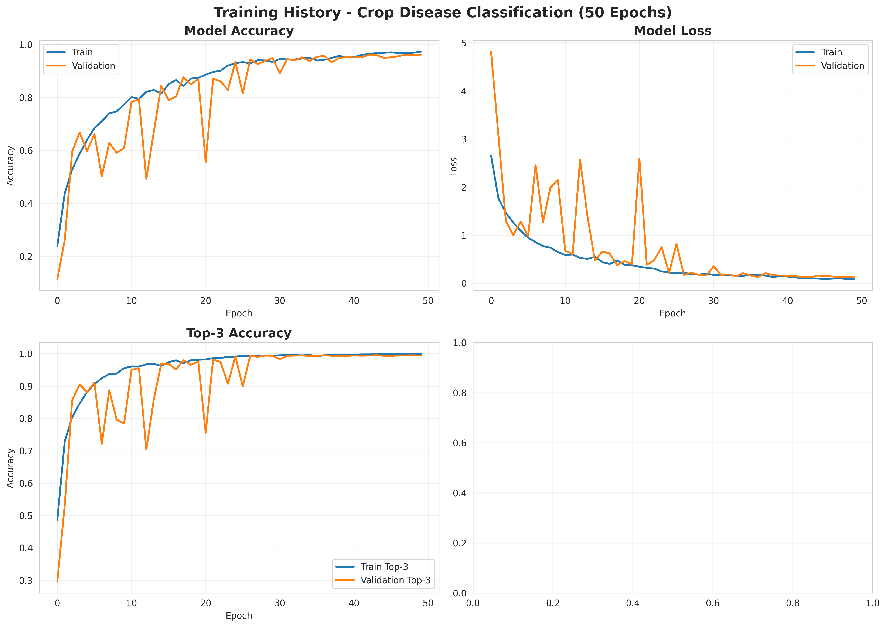

# CropCare AI

A crop-disease assistant for farmers. Photograph a leaf with the Android app and a deep learning model names the disease and suggests treatment. The app also keeps a scan history, shows a soil-sensor dashboard, and offers a voice assistant and a chat with an agronomy expert.



## Parts

| Part | Stack | Status in this repository |
| --- | --- | --- |
| Disease model | TensorFlow / Keras CNN, 128 x 128 input, 33 classes | Configuration, training log and result charts |
| Backend | Flask API that serves the model and a treatment database | `backend/` |
| Android app | Java, Firebase Auth, Firestore and Storage | Source to be added |

## Model

33 classes across cotton, rice, wheat, maize and sugarcane, covering diseases, pests and healthy leaves.

| | |
| --- | --- |
| Training / validation / test images | 17,288 / 3,705 / 3,705 |
| Test accuracy | **96.1%** |
| Test top-3 accuracy | 99.6% |
| Test top-5 accuracy | 99.8% |
| Epochs | 50 |

The full class list and the exact figures are in [`models/model_config.json`](models/model_config.json); the per-epoch log is in [`models/training_log.csv`](models/training_log.csv). A confusion matrix for the 15 largest classes is in [`docs/confusion-matrix-top15.png`](docs/confusion-matrix-top15.png).

## Backend

`backend/app.py` loads the trained model and answers the app.

| Endpoint | Purpose |
| --- | --- |
| `GET /health` | Server and model status |
| `POST /predict` | Takes a leaf image, returns the disease, confidence, severity and treatment steps |
| `POST /predict_demo` | Same response shape without a model, for testing the app |
| `GET /classes` | All disease classes |

```bash
cd backend
pip install -r requirements.txt
python app.py
```

The server expects `best_model.keras`, `label_encoder.pkl` and `model_config.json` in `models/` (or in the folder named by `CROPCARE_MODEL_DIR`). The trained weights and the image dataset are not stored in this repository. The phone and the PC must be on the same network; the app is pointed at the PC's IP address on port 5000.

## App features

- Sign-up and sign-in with Firebase Authentication
- Leaf scan from camera or gallery, with diagnosis, confidence and treatment
- Scan history per user in Firestore
- Soil dashboard for moisture, temperature, humidity and pH, with history. Readings come from a simulator service in the app; the same Firestore documents can be written by real sensors (for example an ESP32).
- Voice assistant
- Expert chat, with an AI mode and a real-expert mode, plus a panel for experts to reply

## Limits

The model was trained on curated leaf photographs. Field photos with poor light, several leaves or diseases outside the 33 classes will be less accurate. Treatment text is general guidance and does not replace a local agronomist.

## Author

Muhammad Umer Khan, [Neurals Solutions](https://neuralssolutions.com)

## License

MIT. See [LICENSE](LICENSE).
